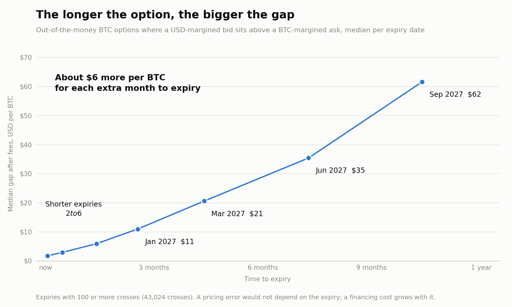

# crypto-vol-arb

Cross-venue implied-volatility dislocations in BTC options: Deribit, OKX, Bybit, Binance.

## Question

The same BTC option (same expiry, strike, call or put) is listed on four venues.
How far apart are their implied vols, how often does one venue's bid sit above
another venue's offer, and does any of it survive fees? This is the crypto
version of multi-listed option vol arbitrage (one underlying, options listed on
US and European exchanges).

## Method v1: the vols each venue publishes (scan sections 0-3)

1. Pull the four public option chains over REST (no API key).
2. Normalise: expiry at 08:00 UTC, strike, call/put, vols as decimals. OKX,
   Bybit and Binance publish bid and ask vols. Deribit quotes inverse options in
   BTC, so its bid and ask vols are solved here with Black-76
   (`xvenue/black76.py`, Newton with a bisection fallback).
3. Deribit convention, checked rather than assumed: BTC premium × the expiry's
   forward reproduces Deribit's own mark IV to a median 0.03 vol points on 232
   liquid strikes; × the spot index misses by 0.56. So the forward is used.
4. Match options across venues; report ATM vols, each venue's gap to Deribit,
   and crossed vol markets gross and net of fees. Fees are turned into vol
   points through vega: fee_pts = 2 × fee / (vega / 100).

```
pip install -r requirements.txt
python -m pytest -q
python scan.py --save      # one snapshot to data/snapshots
python collect.py          # what the scheduler runs every 5 minutes: scan.py --save, one line in data/collect.log
python analyse.py          # the week: results/summary.md and results/gap_vs_expiry.png
python funding.py          # perpetual funding over the same window: results/funding.md
```

## Method v2: prices on one forward (scan sections 4-7)

v1 compared the vols each venue publishes, and each venue computes them on its
own forward. v2 recomputes every vol from prices (`xvenue/common.py`):

1. Every premium in USD today: linear options (USD, USDT, USDC) as quoted,
   inverse options (premium in BTC) times the spot index.
2. Each venue's forward backed out of its own call and put mids by put-call
   parity. With a zero BTC rate and a USD discount factor S / F, inverse and
   linear books give the same relation: (C - P) / S = 1 - K / F.
3. One forward per expiry: the median of the venues' parity forwards.
4. Every bid, ask and mid turned back into a Black-76 vol on that forward, so
   two vols differ only if two prices differ. Crossed markets are counted on
   USD prices, which no forward convention can create or remove.
5. SVI fitted per venue and expiry on out-of-the-money mid vols, weighted by
   1 / bid-ask width (`xvenue/svi.py`), read back as level (ATM vol), skew
   (vol points per +10% log-moneyness) and curvature, with Gatheral's
   butterfly condition and a calendar check (total variance rising with T).

## First snapshot (v1), 2026-11-06 16:01 UTC (BTC index ≈ 75,800)

- Coverage: Deribit 938 options, OKX 1,264 (coin-margined and USD-margined),
  Bybit 686 (USDT-settled), Binance 660.
- ATM vol 37 to 40 % from November 2026 to June 2027, upward sloping. Near the
  money (strikes within 10 % of the forward) Binance marks a median 0.09 vol
  points from Deribit, OKX 0.31, Bybit 0.43, OKX USD-margined 1.11.
- Naive scan, all strikes: 904 crossed markets, 457 still positive after fees.
  Almost all are deep in-the-money options, where the premium is nearly all
  intrinsic, vega is close to zero and a vol is ill-conditioned. Not signal.
- Out-of-the-money options within 25 % log-moneyness: 461 crossed, 167 after
  fees. The largest (≈ 2.4 vol points, March 2027) all involve OKX
  USD-margined, whose March 2027 forward is 76,428 against ≈ 77,400 on the
  other venues, 1.2 % lower. A lower forward lifts call vols and lowers put
  vols for the same USD price, which is exactly the pattern: its calls look
  rich, its puts cheap. **So v1 does not show tradeable arbitrage yet; it shows
  that comparing published vols across venues mixes in their forward
  conventions.**

## Second snapshot (v2), 2026-11-09 16:38 UTC (BTC index ≈ 74,940)

Run from a cloud machine where Bybit (403) and Binance (451) block the request,
so Deribit and OKX only (coin-margined and USD-margined). Rerun from Europe for
all four.

- **The v1 gap was the forward convention, confirmed.** OKX USD-margined
  publishes forwards up to 129 bps below the common forward (March 2027), but
  the forward its own prices imply by put-call parity is within 7 bps.
- Near the money, OKX USD-margined's median absolute gap to Deribit falls from
  1.42 vol points on published vols to 0.33 on the common forward (OKX
  coin-margined: 0.25 to 0.22).
- Crossed markets, out of the money within 25% log-moneyness: 155 gross and 67
  net of fees on published vols; on USD prices, 15 gross and **0 net of fees**.
- All strikes on USD prices: 22 survive fees, all in the money, all March 2027,
  OKX USD-margined against Deribit. In the money the premium is mostly forward,
  so a few bps of difference in the forward or discount rate between a linear
  and an inverse book outweighs the fee. That is a carry difference to price
  with funding and margin, not a vol dislocation.
- SVI: OKX and OKX USD-margined sit within about 0.1 vol point of Deribit on
  level, skew and curvature (median over shared expiries). No butterfly or
  calendar break on any venue. Deribit's ATM vol rises from 37.7 % (November
  2026) to 40.5 % (September 2027); skew goes from -3.2 to -0.6 vol points per
  +10% log-moneyness.

**Reading: on prices and one forward, the venues agree to within fees at this
snapshot. Any vol-arb edge has to come from moments, not from the average
snapshot, which is what the time series (next step) measures.**

## One week of snapshots, 9 to 18 Nov 2026

`collect.py` ran `scan.py --save` every 5 minutes for 7 days (Windows Task
Scheduler, 11 to 18 Nov), after manual runs from 9 Nov, from Paris with all four
venues. `analyse.py` reads the 1,363 snapshots with USD prices and writes
[results/summary.md](results/summary.md) (every table, including each expiry
and venue pair) and the chart below.

Coverage: 1,362 runs saved and 420 failed, out of 2,016 scheduled (68 %). The
PC was off for 18 hours on 13 and 14 Nov, and in the daytime from 15 to 18 Nov
every venue failed at once (no network), so those days hold nights and evenings
only.

Out-of-the-money options (|ln K/F| ≤ 0.25), on USD prices, after fees:

| Measure | Value |
|---|---|
| Crossed quotes after fees | 43,794 |
| Snapshots with at least one | 1,360 of 1,363 |
| Median gap | $20.1 per BTC (2.9 bps of spot) |
| 90th percentile, largest | $63.5, $664.5 |
| Episodes seen in one snapshot only | 54 % of 11,842 |
| Longest episode | 277 snapshots (about 23 h) |

| Direction | Crosses | Share | Median gap |
|---|---|---|---|
| USD-margined bid above BTC-margined ask | 43,364 | 99.0 % | $20.3 |
| USD-margined on both sides | 326 | 0.7 % | $1.6 |
| BTC-margined bid above any ask | 104 | 0.2 % | $2.3 |



**Reading: the crosses are carry, not arbitrage.**

- They go one way. A USD-margined book (Binance, Bybit USDT, OKX USD-margined)
  bids above a BTC-margined one (Deribit, OKX coin-margined) in 99 % of the
  crosses. Between two USD-margined books the median gap is $1.6.
- It happens inside one exchange: OKX's USD-margined book bid above its own
  coin-margined book 2,253 times (median $14.4).
- The gap grows with time to expiry, from about $2 for options a few days out to
  $62 for September 2027, about $6 per BTC for each extra month. A pricing error
  would not depend on the expiry; a financing cost does.
- Collecting it means buying on the BTC-margined venue, selling on the
  USD-margined one and holding both to expiry: BTC paid on one side, USDT margin
  locked on the other and topped up if BTC rallies, on two exchanges. The gap is
  about what that collateral costs over the life of the option.

### The carry, as a rate

Every out-of-the-money option quoted on both a USD-margined and a BTC-margined
book, crossed or not, 30 days out or more (476,555 pairs): (USD-margined mid -
BTC-margined mid) / BTC-margined mid / time to expiry. Shorter expiries are left
out: their options cost a few ticks, and tick noise divided by a few days swamps
the rate.

| Expiry | Days to expiry | Options carry, median per year | 25th to 75th percentile | Futures basis per year |
|---|---|---|---|---|
| 2026-12-25 | 42 | 7.1 % | -4.8 % to 20.2 % | 5.7 % |
| 2027-01-29 | 76 | 7.9 % | 2.3 % to 11.2 % | 5.6 % |
| 2027-03-26 | 133 | 6.0 % | 3.4 % to 7.6 % | 5.6 % |
| 2027-06-25 | 224 | 5.7 % | 4.5 % to 7.3 % | 5.7 % |
| 2027-09-24 | 315 | 5.7 % | 4.6 % to 6.9 % | 5.7 % |

The futures basis is ln(F / spot) / T, from each expiry's forward in the same
snapshots.

- USD-margined books price the same option about 6 % a year above BTC-margined
  ones (median 6.2 %). From four months out the rate holds near 6 % and its
  spread narrows. A rate that stays put across expiries is a financing cost; a
  vol or pricing mismatch has no reason to be proportional to time.
- Every venue pair gives 5.8 % to 6.6 %, OKX against itself included (6.4 %).
- Calls carry more of it than puts (8.5 % against 2.8 % a year), so part of it
  is the USD-margined books pricing off a higher forward. That is carry too: the
  forward is spot plus the cost of funding.
- **That rate is the BTC futures basis.** The forward sits 5.6 to 5.7 % a year
  above spot at every expiry, and from six months out the options carry matches
  it (5.7 %). Perpetual funding over the same 8.5 days (`funding.py`,
  [results/funding.md](results/funding.md)) ran at 3.7 % to 5.1 % a year on the
  USDT perpetuals and 2.3 % on Deribit's inverse one.
- So a USD-margined option costs about the BTC-margined premium converted at the
  forward instead of spot. Collecting the difference ties up capital that a
  cash-and-carry trade (buy spot, sell the future) pays the same 5.7 % a year:
  it is the price of money in crypto, not an arbitrage.

## Assumptions and limits

- Fees: one taker fee per leg for every venue, 0.03 % of the underlying capped
  at 12.5 % of the premium. Each venue's real schedule replaces this in v2.
- Top of book only; Deribit and Binance sizes are not read yet.
- Venues are read one after the other: a full run takes a median 18 s, so the
  two quotes of a cross can be that far apart.
- Snapshots are 5 minutes apart: a cross that opens and closes in between is
  missed, and an episode's length is known to 5 minutes.
- Inverse (Deribit, OKX coin-margined) and linear (USDT) payoffs are compared
  on vols only; the BTC-settled payoff changes the hedge, not the vol.
- v2: USDT and USDC counted as USD; zero BTC rate and a USD discount factor of
  S / F, the same for every venue. Bybit's and Binance's price fields
  (`bid1Price`, `ask1Price`; ticker `bidPrice`, `askPrice`) were not reachable
  from the machine the second snapshot ran on; the week of snapshots, run from
  Paris, reads them.

## Next

Done: one forward per expiry from prices and SVI per venue with butterfly and
calendar checks (v2); all four venues from Europe and a week of 5-minute
snapshots (above).

1. Read sizes and depth, and each venue's real fee schedule: how much could
   actually be traded.
2. Margin: how much capital each venue ties up per contract, which sets the
   return on capital of collecting the gap against the 5.7 % basis.
3. Delta hedge with perpetuals and pay funding; simulate the vol-arb P&L with
   fees, slippage and latency.
